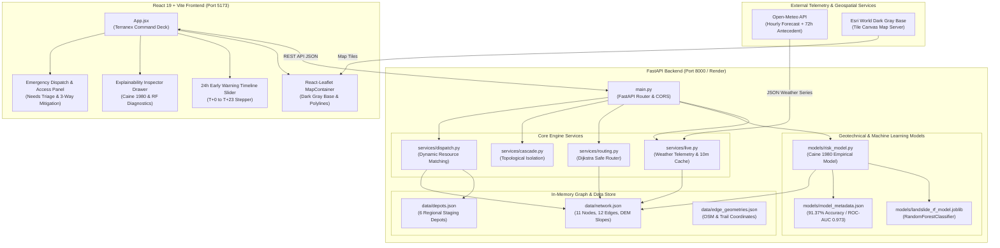
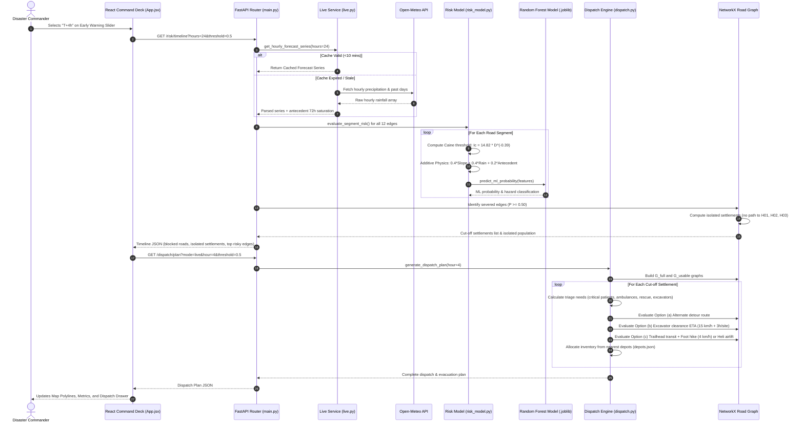
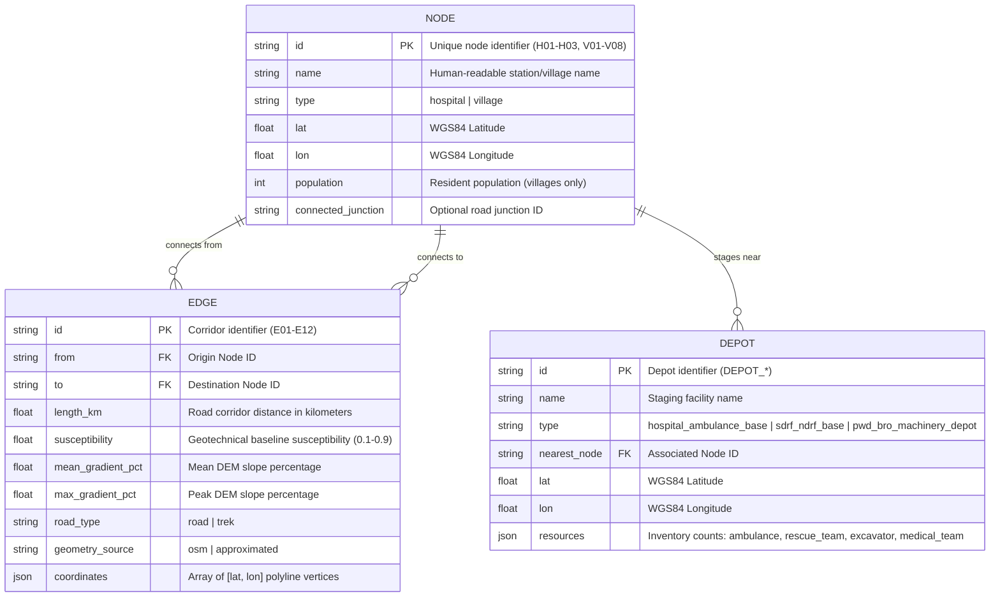

# Terranex — Master Project Context & Architectural Knowledge Base

**Last Verified:** October 19, 2026  
**Repository Root:** `.`  
**Project Version:** `v0.2.0`  
**System Scope:** Adaptive Landslide Intelligence, Early Warning & Emergency Decision Support System  
**Target Geographical Region:** Rudraprayag District, Garhwal Himalayas, Uttarakhand, India  

---

## Table of Contents
1. [Project Overview](#1-project-overview)
2. [Product Goals and Core Concepts](#2-product-goals-and-core-concepts)
3. [Feature Inventory and Implementation Status](#3-feature-inventory-and-implementation-status)
4. [Technology Stack](#4-technology-stack)
5. [Repository Structure](#5-repository-structure)
6. [High-Level System Architecture](#6-high-level-system-architecture)
7. [Architecture Diagrams](#7-architecture-diagrams)
8. [Frontend Architecture](#8-frontend-architecture)
9. [Backend Architecture](#9-backend-architecture)
10. [API Reference](#10-api-reference)
11. [Database Schema and Relationships (Topological Data Store)](#11-database-schema-and-relationships-topological-data-store)
12. [End-to-End Feature Workflows](#12-end-to-end-feature-workflows)
13. [External Services and Integrations](#13-external-services-and-integrations)
14. [Code Execution / Background Processing (Applicability Assessment)](#14-code-execution--background-processing-applicability-assessment)
15. [Authentication and Security](#15-authentication-and-security)
16. [Environment Variables and Configuration](#16-environment-variables-and-configuration)
17. [Local Development Setup](#17-local-development-setup)
18. [Build, Testing, and Deployment](#18-build-testing-and-deployment)
19. [Important Files and Code Navigation](#19-important-files-and-code-navigation)
20. [Change Impact Guide](#20-change-impact-guide)
21. [Known Issues and Technical Debt](#21-known-issues-and-technical-debt)
22. [Roadmap and Pending Work](#22-roadmap-and-pending-work)
23. [AI Coding Assistant Instructions](#23-ai-coding-assistant-instructions)
24. [Documentation Limitations and Unverified Details](#24-documentation-limitations-and-unverified-details)

---

## 1. Project Overview

**Terranex** (*Terra* [Terrain] + *Nex* [Next Connection]) is an emergency decision-support and geospatial intelligence platform engineered specifically for **Rudraprayag District, Uttarakhand**, in the Garhwal Himalayas.

### Operational Context
During intense South Asian monsoon cloudbursts and continuous torrential rainfall events, steep Himalayan valley slopes experience cascading shallow landslides and debris flows. In Rudraprayag, these mass-wasting events routinely sever the National Highway 107 (NH-107) corridor along the Mandakini river and the high-altitude pilgrimage routes leading to Kedarnath, Triyuginarayan, and upper valley habitations. As roads collapse, thousands of residents and pilgrims become isolated from emergency medical hubs and critical supplies.

### Purpose
Terranex replaces fragmented disaster spreadsheets and static hazard maps with a dynamic, graph-driven, physics-calibrated decision deck. It equips disaster commanders at District Disaster Management Authorities (DDMA), State Disaster Response Force (SDRF), National Disaster Response Force (NDRF), and Public Works Department (PWD/BRO) with:
1. **Hour-by-hour 24-hour predictive early warning** of corridor blockages before rainfall peaks.
2. **Explainable geotechnical risk evaluation** uniting empirical physics (Caine 1980 threshold) with a calibrated supervised Machine Learning classifier (`RandomForestClassifier`, 91.37% accuracy).
3. **Dynamic resource matching** that cross-references population triage needs against actual inventory at 6 staging depots.
4. **Multimodal evacuation routing** that determines viable surface ambulance routes, heavy machinery clearance turnaround times, or automatic helicopter airlift escalation.

---

## 2. Product Goals and Core Concepts

### Core Product Objectives
- **Zero Black-Box Scoring:** Every road segment's risk must be traceable down to its constituent geotechnical drivers: terrain slope percentage, rainfall intensity vs. Caine threshold ratio, and 72-hour antecedent soil moisture.
- **Topological Cascade Analysis:** Moving beyond simple radius buffers by computing true graph reachability across the road network to identify trapped settlements.
- **Actionable Logistics Triage:** Translating abstract hazard scores into concrete operational units: numbers of required ambulances, rescue teams, heavy excavators, medical staff, and emergency food/water kits.

### Key Domain Terminology
| Concept | Definition & Implementation |
|---|---|
| **Caine (1980) Critical Intensity** | Empirical shallow-landslide threshold: $I_c = 14.82 \times D^{-0.39}\text{ mm/hr}$. For a standard 1-hour cloudburst ($D=1.0$), $I_c = 14.82\text{ mm/hr}$. |
| **Antecedent Soil Moisture ($R_{72}$)** | Decayed antecedent rainfall weighting soil saturation: $R_{72} = 0.5 \times R_{24-48\text{h}} + 0.25 \times R_{48-72\text{h}}$. |
| **Probability of Blockage $P \in [0.0, 1.0]$** | Additive empirical risk: $0.40 \times \text{SlopeFactor} + 0.40 \times \text{RainFactor} + 0.20 \times \text{AntecedentFactor}$. |
| **Blockage Threshold** | Default probability threshold ($0.50$) at or above which a road segment is deemed impassable (`blocked = true`). |
| **Cut-off Settlement** | A village or town node that possesses zero open topological paths to any designated hospital base. |
| **Multimodal Access Mitigation** | 3-way access evaluation for severed nodes: (a) Alternate detour, (b) Excavator clearance ETA ($15\text{ km/h}$ transit + $3\text{ hrs/site}$ clearance), (c) Foot trek ($4\text{ km/h}$) or Aerial helicopter airlift if hike $>12\text{ km}$ or $>4\text{ hrs}$. |

---

## 3. Feature Inventory and Implementation Status

| Feature Name | Status | Key Source Files | Existing Dependencies | Missing / Unimplemented Pieces |
|---|---|---|---|---|
| **Real-time Live Mode** | **Implemented & Verified** | [`backend/services/live.py`](file:///c:/Study/Hekathon/Innotech%202026/Terranex/backend/services/live.py), [`backend/main.py`](file:///c:/Study/Hekathon/Innotech%202026/Terranex/backend/main.py), [`frontend/src/App.jsx`](file:///c:/Study/Hekathon/Innotech%202026/Terranex/frontend/src/App.jsx) | Open-Meteo API, Python `urllib` | Live radar rain gauge ingest from IMD (currently relies on Open-Meteo forecast models). |
| **Interactive Crisis Simulator** | **Implemented & Verified** | [`frontend/src/App.jsx`](file:///c:/Study/Hekathon/Innotech%202026/Terranex/frontend/src/App.jsx), [`backend/main.py`](file:///c:/Study/Hekathon/Innotech%202026/Terranex/backend/main.py) | Sliders, `/risk/simulation` | Custom user-drawn road disruption overrides. |
| **24-Hour Early Warning Timeline** | **Implemented & Verified** | [`backend/main.py`](file:///c:/Study/Hekathon/Innotech%202026/Terranex/backend/main.py), [`frontend/src/App.jsx`](file:///c:/Study/Hekathon/Innotech%202026/Terranex/frontend/src/App.jsx) | `/risk/timeline`, Play/Pause stepper | T+48h or 7-day multi-day outlook. |
| **Explainable Risk Model (Caine 1980)** | **Implemented & Verified** | [`backend/models/risk_model.py`](file:///c:/Study/Hekathon/Innotech%202026/Terranex/backend/models/risk_model.py) | Mathematical Caine formula, DEM slope | Regional GSI/ISRO landslide inventory calibration. |
| **Supervised ML Model (`RandomForest`)** | **Implemented & Verified** | [`backend/models/risk_model.py`](file:///c:/Study/Hekathon/Innotech%202026/Terranex/backend/models/risk_model.py), [`backend/models/train_ml_model.py`](file:///c:/Study/Hekathon/Innotech%202026/Terranex/backend/models/train_ml_model.py) | `joblib`, `scikit-learn`, `numpy` | Online continuous retraining pipeline; currently static serialized `.joblib`. |
| **Topological Road Graph & Geometries** | **Implemented & Verified** | [`backend/data/network.json`](file:///c:/Study/Hekathon/Innotech%202026/Terranex/backend/data/network.json), [`backend/services/routing.py`](file:///c:/Study/Hekathon/Innotech%202026/Terranex/backend/services/routing.py) | NetworkX, OpenStreetMap | High-altitude trail splines (E06, E07, E08, E09, E12) are DEM approximations, not survey-grade GPS. |
| **Resource Depots Inventory** | **Implemented & Verified** | [`backend/data/depots.json`](file:///c:/Study/Hekathon/Innotech%202026/Terranex/backend/data/depots.json), [`backend/services/dispatch.py`](file:///c:/Study/Hekathon/Innotech%202026/Terranex/backend/services/dispatch.py) | Static JSON data | Real-time GPS telematics on individual response vehicles. |
| **Dynamic Multi-Resource Dispatch Plan** | **Implemented & Verified** | [`backend/services/dispatch.py`](file:///c:/Study/Hekathon/Innotech%202026/Terranex/backend/services/dispatch.py) | NetworkX, Triage formulas | Multi-depot cooperative convoy scheduling. |
| **Multimodal Evacuation Routing** | **Implemented & Verified** | [`backend/services/dispatch.py`](file:///c:/Study/Hekathon/Innotech%202026/Terranex/backend/services/dispatch.py), [`backend/services/routing.py`](file:///c:/Study/Hekathon/Innotech%202026/Terranex/backend/services/routing.py) | Dijkstra shortest path | Real-time road clearance feedback loop updating graph weights dynamically. |
| **Interactive Map Canvas** | **Implemented & Verified** | [`frontend/src/App.jsx`](file:///c:/Study/Hekathon/Innotech%202026/Terranex/frontend/src/App.jsx) | React-Leaflet, Esri Dark Gray Base | 3D terrain elevation mesh (e.g. Mapbox/Cesium). |
| **User Authentication / RBAC** | **Not Implemented** | None | None | Public open access for hackathon / disaster operations center demonstration. |

---

## 4. Technology Stack

### Frontend
- **Framework & Core:** React 19 (`react: ^19.2.8`, `react-dom: ^19.2.8`) with Vite 8 (`vite: ^8.3.0`, `@vitejs/plugin-react: ^6.1.1`).
- **Styling & Design System:** Tailwind CSS v4 (`@tailwindcss/vite: ^4.3.3`, `tailwindcss: ^4.3.3`) with `tw-animate-css: ^1.4.0` and Shadcn UI components.
- **Geospatial Mapping:** Leaflet (`leaflet: ^1.9.4`) and React-Leaflet (`react-leaflet: ^5.0.0`).
- **Base Tile Provider:** Esri World Dark Gray Base (`https://server.arcgisonline.com/ArcGIS/rest/services/Canvas/World_Dark_Gray_Base/MapServer/tile/{z}/{y}/{x}`). No API key required; clean dark theme canvas.
- **UI Components:** `@base-ui/react: ^1.9.0`, `class-variance-authority: ^0.7.1`, `cn: ^0.4.0`.
- **Icons & Typography:** `@hugeicons/react: ^1.1.10`, `@fontsource-variable/figtree: ^5.3.0`.
- **Code Quality:** `oxlint: ^1.81.0`.

### Backend
- **Framework:** FastAPI (`>=0.110.0`) with Starlette async ASGI runtime.
- **ASGI Server:** Uvicorn (`uvicorn[standard]>=0.28.0`).
- **Graph & Network Algorithms:** NetworkX (`networkx>=3.2.0`) for topological routing, connected components, and Dijkstra path calculation.
- **Machine Learning & Mathematics:**
  - `scikit-learn>=1.4.0`: `RandomForestClassifier` inference engine.
  - `joblib>=1.3.0`: Model serialization and rapid memory-mapped deserialization.
  - `numpy>=1.26.0`: Numerical array manipulation and vectorized feature matrix generation.
- **HTTP / Telemetry:** Python standard library `urllib.request` and `urllib.parse` for Open-Meteo REST calls.

### Storage & Persistence
- **Topological Database:** In-memory graph instantiated directly from structured JSON files (`backend/data/network.json`, `backend/data/depots.json`).
- **In-Memory Cache:** Python dictionary in `services/live.py` with 600-second (10-minute) TTL for Open-Meteo telemetry.
- **Serialized Artifacts:** `backend/models/landslide_rf_model.joblib` (1.11 MB) and `backend/models/model_metadata.json` (1.05 KB).

### Infrastructure & Deployment
- **Backend Hosting:** Render (`https://terranex-backend.onrender.com`), launched via [`backend/Procfile`](file:///c:/Study/Hekathon/Innotech%202026/Terranex/backend/Procfile):
  ```
  web: uvicorn main:app --host 0.0.0.0 --port $PORT
  ```
- **Frontend Hosting:** Static bundle built with `npm run build` targeting modern browser runtimes.
- **Environment Configuration:** Handled via Vite build environment (`frontend/.env`).

---

## 5. Repository Structure

```
Terranex/
├── README.md                      # High-level product overview, capabilities, and quickstart
├── CONTEXT.md                     # Master architectural and codebase context (This Document)
├── backend/
│   ├── Procfile                   # Render deployment process declaration
│   ├── main.py                    # FastAPI application entry point, route registration, CORS
│   ├── requirements.txt           # Python dependency specification
│   ├── data/
│   │   ├── depots.json            # 6 Emergency resource staging depots and equipment inventories
│   │   ├── network.json           # Active topological road network (11 nodes, 12 edges, DEM slopes)
│   │   ├── edge_geometries.json   # High-resolution coordinate polylines for edges
│   │   ├── osm_roads_raw.geojson  # Raw Overpass OpenStreetMap extraction
│   │   └── network_backup.json    # Safety snapshot of earlier network versions
│   ├── models/
│   │   ├── risk_model.py          # Caine (1980) empirical physics model, RF inference, isolation logic
│   │   ├── train_ml_model.py      # Scikit-learn training script for Random Forest classifier
│   │   ├── landslide_rf_model.joblib # Serialized scikit-learn model artifact
│   │   └── model_metadata.json    # ML hyperparameters, feature list, and evaluation metrics
│   ├── services/
│   │   ├── cascade.py             # Graph isolation calculation and resource prioritization
│   │   ├── dispatch.py            # Dynamic multi-depot triage, 3-way mitigation, patient evacuation
│   │   ├── live.py                # Open-Meteo API ingest, single-point & multi-village telemetry, caching
│   │   ├── routing.py             # Safe Dijkstra routing, risk cost weights, path summarization
│   │   ├── process_osm_roads.py   # OSM road ingestion helper
│   │   └── inspect_osm.py         # OSM node/edge sanity inspector
│   └── scripts/                   # Verification, geometry tuning, and test automation
│       ├── test_api_endpoints.py  # Synchronous end-to-end endpoint verification
│       ├── audit_endpoints.py     # FastAPI TestClient audit runner
│       ├── verify_risk_model.py   # Caine formula monotonicity & reason tracking verifier
│       ├── verify_dispatch.py     # Dispatch engine unit verification
│       ├── verify_all.py          # Unified system verification suite
│       ├── build_network.py       # Graph assembly pipeline uniting OSM and DEM elevation
│       └── terrain.py             # SRTM elevation query & slope gradient calculation
└── frontend/
    ├── .env                       # Environment configuration (VITE_API_URL)
    ├── package.json               # NPM scripts, React 19, Leaflet, and UI dependencies
    ├── vite.config.js             # Vite 8 config with Tailwind v4 & alias plugins
    ├── components.json            # Shadcn UI configuration
    ├── index.html                 # HTML entry point with title and meta tags
    └── src/
        ├── App.jsx                # Main unified Crisis Command Deck component
        ├── App.css                # Component-specific styles
        ├── index.css              # Tailwind CSS v4 design tokens, theme variables, and fonts
        ├── main.jsx               # React DOM root render mount
        ├── lib/
        │   └── utils.js           # Reusable className concatenation utility (clsx / tw-merge)
        └── components/
            └── ui/                # Shadcn UI primitive components
                ├── alert.jsx      # Alert banners
                ├── badge.jsx      # Categorical hazard tags
                ├── button.jsx     # Button primitives
                ├── card.jsx       # Diagnostic container cards
                ├── slider.jsx     # Early warning & simulation sliders
                └── tabs.jsx       # Command deck view switchers
```

---

## 6. High-Level System Architecture

Terranex operates as an asynchronous, decoupled client-server architecture:

1. **Weather Telemetry Layer:** Communicates with the public Open-Meteo API to obtain real-time precipitation rates, 72-hour antecedent soil moisture history, and 24-hour hour-by-hour forecast series.
2. **Geotechnical Physics & ML Engine:** Evaluates terrain failure probability across every road segment using Digital Elevation Model (DEM) gradients, empirical rainfall thresholds (Caine 1980), and an ensemble Random Forest classifier.
3. **Graph Topology & Routing Layer:** Maintained in memory via NetworkX. Transforms continuous hazard probabilities into binary operational states (`operational` vs. `blocked`), updates edge traversal costs, and performs Dijkstra pathfinding to determine isolated settlements.
4. **Logistics & Dispatch Triage Engine:** Takes identified cut-off settlements, applies demographic disaster triage formulas, assigns resources from 6 regional depots, evaluates 3-way mitigation access routes, and formulates patient evacuation protocols.
5. **Interactive Command Deck UI:** A single-page dashboard built on React 19, Leaflet, and Tailwind v4. Renders dynamic map polylines, custom node icons, an interactive 24-hour timeline stepper, and diagnostic inspection drawers.

---

## 7. Architecture Diagrams

### 7.1 Component Architecture Diagram



### 7.2 End-to-End Request & Data Flow Sequence Diagram



---

## 8. Frontend Architecture

### Core Design Philosophy
The frontend is constructed as a high-density, mission-critical Command Deck designed to eliminate cognitive fatigue during crisis operations:
- **Clean Basemap Canvas:** Uses Esri World Dark Gray Base (zero watermarks, zero API key dependencies, low visual noise).
- **Dynamic Polyline Gradients:** Road segments dynamically shift color according to real-time failure probability:
  - Green (`#10b981`): Operational ($P < 0.25$)
  - Amber (`#eab308`): Elevated Risk ($0.25 \le P < 0.45$)
  - Orange (`#f97316`): Severe Hazard Warning ($0.45 \le P < 0.60$)
  - Crimson Red (`#ef4444`): Critical Blockage / Severed ($P \ge 0.60$)
- **Custom Distinct Node Markers:**
  - Hospitals: Red medical cross pins (`+`) with glowing halo indicator.
  - Villages: Emerald circle markers with population tooltips.
  - Resource Depots: SVG badges (Gears `⚙` for PWD/BRO machinery, Shields `🛡` for SDRF/NDRF, Crosses `✚` for Ambulance bases).

### Key State Management (`frontend/src/App.jsx`)
State is managed locally in React with reactive side-effect hooks synchronizing across the map and side panel:

| State Variable | Type | Purpose |
|---|---|---|
| `mode` | `"live" \| "simulation"` | Active operational mode. Toggles between live telemetry and crisis sliders. |
| `timelineData` | `Object \| null` | 24-hour hour-by-hour projection data received from `/risk/timeline`. |
| `currentHour` | `number` ($0-23$) | Current timeline step selected on the slider or driven by auto-play. |
| `isPlaying` | `boolean` | Auto-stepper toggle advancing timeline hour every 1400ms. |
| `simRain`, `simPrior1`, `simPrior2` | `number` | Crisis simulation parameters ($0-150\text{ mm}$ rain, $0-80\text{ mm}$ prior wet days). |
| `simThreshold` | `number` | Failure probability cut-off threshold (default: $0.50$). |
| `network` | `Object \| null` | Node coordinates and edge geometries from `/network`. |
| `depots` | `Array` | Staging bases and available equipment counts from `/depots`. |
| `dispatchPlan` | `Object \| null` | Complete resource allocation and evacuation response from `/dispatch/plan`. |
| `selectedSegmentId` | `string` | Currently inspected corridor (`"E06"` default) displayed in diagnostic drawer. |
| `selectedSegmentData`| `Object \| null` | Detailed Caine (1980) breakdown and ML score from `/risk/segment/{id}`. |
| `rightTab` | `"explain" \| "timeline" \| "dispatch"` | Active side drawer view. |
| `mobileTab` | `"map" \| "panel"` | Responsive view switcher for mobile displays. |

### Component Structure
- [`src/App.jsx`](file:///c:/Study/Hekathon/Innotech%202026/Terranex/frontend/src/App.jsx): Master container orchestrating:
  - Top Command Header (`<header>`) with mode switcher.
  - Situational Metrics Grid (Rainfall rate, severed corridors, cut-off population, active depots, patient evacuation state).
  - Center Map Container (`<MapContainer>`) with `MapController`, `Polyline`, `CircleMarker`, and `Marker` layers.
  - Bottom Timeline / Simulation Control Deck (Play/pause stepper, timeline slider, preset buttons).
  - Right Crisis Panel (`Tabs`):
    - **Tab 1 (Explainability):** Diagnostic meter, narrative reason explanation, 3-component breakdown, and ML prediction card.
    - **Tab 2 (Early Warning):** Hour-by-hour crisis progression list with threat corridor identification.
    - **Tab 3 (Dispatch Plan):** Triage needs, patient evacuation pathways, 3-way access mitigation, and assigned equipment.

---

## 9. Backend Architecture

### Application Initialization (`backend/main.py`)
- Instantiates `FastAPI(title="Terranex API", version="0.2.0")`.
- Configures permissive `CORSMiddleware` (`allow_origins=["*"]`, `allow_methods=["*"]`, `allow_headers=["*"]`) ensuring cross-origin requests from local Vite servers and production web frontends resolve without friction.
- Exposes REST endpoints across 5 core domains: Health & Status, Machine Learning, Risk & Early Warning, Dynamic Dispatch, and Telemetry/Network.

### Mathematical Risk Formulation (`backend/models/risk_model.py`)
Each road segment $e$ evaluates a failure probability $P(e) \in [0.0, 1.0]$:

$$P(e) = 0.40 \times S_{\text{factor}} + 0.40 \times R_{\text{factor}} + 0.20 \times A_{\text{factor}}$$

1. **Slope Component ($S_{\text{factor}}$):**
   $$S_{\text{factor}} = \min\left(1.0, \max\left(0.05, \frac{\text{SlopeGradient}\%}{50.0}\right)\right)$$
   *(50% gradient / 26.5° represents high steepness baseline in Uttarakhand Himalayas).*
2. **Rainfall Intensity vs Caine 1980 ($R_{\text{factor}}$):**
   $$I_c = 14.82 \times D^{-0.39} \quad [\text{mm/hr}]$$
   $$R_{\text{factor}} = \min\left(1.0, \frac{\text{HourlyRainfall}_{\text{mm}}}{I_c}\right)$$
3. **Antecedent Saturation Component ($A_{\text{factor}}$):**
   $$A_{72} = 0.5 \times R_{24-48\text{h}} + 0.25 \times R_{48-72\text{h}} \quad [\text{mm}]$$
   $$A_{\text{factor}} = \min\left(1.0, \frac{A_{72}}{50.0}\right)$$

### Machine Learning Engine (`backend/models/`)
- **Model Architecture:** Scikit-learn `RandomForestClassifier` (100 estimators, max depth 12).
- **Features (8 domain inputs):**
  1. `mean_gradient_pct`: Segment average slope gradient from DEM.
  2. `max_gradient_pct`: Peak slope gradient along segment.
  3. `hourly_rainfall_mm`: Active or forecasted precipitation rate.
  4. `caine_threshold_mm_hr`: Critical empirical threshold for 1-hour duration ($14.82\text{ mm/hr}$).
  5. `caine_ratio`: $\text{Rainfall} / I_c$.
  6. `antecedent_72h_mm`: Cumulative decayed antecedent saturation.
  7. `elevation_m`: Mean elevation above sea level ($1500\text{ m}$ baseline).
  8. `geotechnical_susc`: Inherent lithological and structural susceptibility index ($0.10 - 0.90$).
- **Verified Metrics (`model_metadata.json`):**
  - Accuracy: **91.37%**
  - ROC-AUC: **0.9730**
  - Precision: **93.24%**
  - Recall: **93.06%**
  - F1-Score: **93.15%**
- **Top Feature Importances:**
  - `hourly_rainfall_mm`: 23.49%
  - `caine_ratio`: 19.78%
  - `mean_gradient_pct`: 18.86%
  - `max_gradient_pct`: 17.84%
  - `geotechnical_susc`: 9.29%

### Resource Dispatch & Logistics Engine (`backend/services/dispatch.py`)
- **Triage Calculation:**
  - Critical Acute Patients: $1.5\%$ of cut-off population.
  - Ambulances Needed: $\lceil\text{patients} / 4\rceil$ (4 casualties per turnaround cycle).
  - Search & Rescue Teams: $\lceil\text{population} / 800\rceil$ (1 multi-person SDRF team per 800 residents).
  - Medical Teams: $\lceil\text{patients} / 10\rceil$.
  - Excavator Requirement: $1$ heavy machine per severed access axis.
  - Relief Kits: $1$ food/water/blanket kit per resident.
- **Access Mitigation Evaluation:**
  - **Option (a) Alternate Detour:** Tests whether an unblocked contiguous path exists in $G_{\text{usable}}$.
  - **Option (b) Excavator Clearance:** Finds severed edges along the shortest topological path in $G_{\text{full}}$, computes transit time at $15\text{ km/h}$, adds $180\text{ minutes}$ (3 hours) per landslide blockage site.
  - **Option (c) Aerial / Foot Transit:** Finds the closest reachable roadhead from staging bases; calculates driving time at $35\text{ km/h}$ plus foot hike at $4\text{ km/h}$. Automatically escalates to `aerial_airlift_required` (`HIGH` urgency) if foot hike exceeds $12\text{ km}$ or $4\text{ hours}$.

---

## 10. API Reference

All endpoints return JSON responses. No authentication headers are required.

| Method | Endpoint | Purpose | Key Query Parameters | Main Handler | Response Summary |
|---|---|---|---|---|---|
| `GET` | `/` | System root health check & status | None | `main.home()` | API status, project title, study area, and ML model loaded flag. |
| `GET` | `/health` | Liveness health probe | None | `main.health()` | `{"status": "ok", "ml_model_status": "ready"}`. |
| `GET` | `/ml/status` | Model architecture & metrics | None | `main.ml_model_status()` | Algorithm name, accuracy, ROC-AUC, feature importances. |
| `GET` | `/ml/predict` | Direct ML corridor inference | `mean_gradient_pct`, `hourly_rainfall_mm`, `duration_hours`, etc. | `main.ml_predict_corridor()` | Normalized feature dict, ML probability, and hazard class. |
| `GET` | `/risk/timeline` | 24-Hour early warning projection | `hours` (default: 24), `threshold` (default: 0.50) | `main.risk_timeline()` | Hour-by-hour forecast series, blocked road counts, isolated population, per-edge probabilities. |
| `GET` | `/risk/segment/{segment_id}` | Detailed Caine (1980) explainability | `rainfall_mm`, `prior1`, `prior2`, `threshold` | `main.risk_segment()` | Transparent 3-driver breakdown, dominant cause, narrative explanation, and ML inference. |
| `GET` | `/risk/simulation` | Global simulation across all segments | `rainfall_mm`, `prior1`, `prior2`, `threshold` | `main.risk_simulation()` | Full network evaluation under custom rainfall loads. |
| `GET` | `/depots` | Emergency staging bases inventory | None | `main.get_depots()` | Array of 6 staging bases with live available equipment counts. |
| `GET` | `/dispatch/plan` | Dynamic resource dispatch plan | `mode` (`"live"\|"simulation"`), `hour`, `rainfall_mm`, `prior1`, `prior2` | `main.dispatch_plan()` | Cut-off settlements triage, assigned equipment units, 3-way mitigation, and patient evacuation status. |
| `GET` | `/network` | Graph topological state | `rainfall_mm`, `per_village`, `basis` | `main.network()` | Node coordinates, edge attributes, and road blockage flags. |
| `GET` | `/live/rainfall` | Single-point weather telemetry | None | `main.live_rainfall()` | Observed precipitation rate, past 24h, 24-48h, 48-72h, and next 24h forecast. |
| `GET` | `/live/villages` | Multi-location weather telemetry | None | `main.live_villages()` | Array of weather telemetry across all 8 village coordinates. |
| `GET` | `/route/safe` | Safest viable evacuation path | `source` (Node ID), `target` (Node ID, optional), `rainfall_mm` | `main.safe_route()` | Dijkstra safe route avoiding high-hazard roads, normal route comparison, `has_foot_trek` flag. |
| `GET` | `/simulate/cascade` | Deterministic cascade connectivity | `rainfall_mm`, `per_village`, `basis` | `main.cascade()` | Isolated villages list, total population cut-off, and isolation scores. |
| `GET` | `/prioritize/resources` | Legacy resource prioritization | `rainfall_mm`, `per_village`, `basis` | `main.resources()` | Assigns 2 ambulances, 2 rescue teams, and 1 excavator to highest-population isolated villages. |

---

## 11. Database Schema and Relationships (Topological Data Store)

The application does not use a SQL database server; its schema is structured as topological JSON data files in `backend/data/` that are mapped directly into memory as relational node-edge graphs.

### Entity Relationship Model



### Node Inventory (11 Nodes)
- **Hospitals (3 Nodes):**
  - `H01`: District Hospital Rudraprayag (`30.2844, 78.9811`)
  - `H02`: CHC Ukhimath (`30.518, 79.091`)
  - `H03`: PHC Guptkashi (`30.525, 79.071`)
- **Settlements & Pilgrim Corridors (8 Nodes):**
  - `V01`: Augustmuni (Pop: 2,100)
  - `V02`: Ukhimath (Pop: 1,850)
  - `V03`: Guptkashi (Pop: 2,400)
  - `V04`: Sonprayag (Pop: 980)
  - `V05`: Kedarnath (Pop: 1,200)
  - `V06`: Rambara (Pop: 650)
  - `V07`: Phata (Pop: 1,100)
  - `V08`: Triyuginarayan (Pop: 890)

### Edge Inventory (12 Corridors)
| ID | From | To | Length | Susc. | Mean Slope | Max Slope | Road Type | Geometry Source |
|---|---|---|---|---|---|---|---|---|
| `E01` | H01 | V01 | 18.00 km | 0.33 | 3.6% | 18.4% | `road` | `osm` |
| `E02` | V01 | V03 | 27.00 km | 0.49 | 9.9% | 25.9% | `road` | `osm` |
| `E03` | V01 | V02 | 21.85 km | 0.25 | 3.2% | 7.3% | `road` | `osm` |
| `E04` | V03 | V02 | 16.74 km | 0.57 | 17.3% | 37.6% | `road` | `osm` |
| `E05` | V03 | V07 | 22.84 km | 0.41 | 4.8% | 22.9% | `road` | `osm` |
| `E06` | V07 | V04 | 22.00 km | 0.74 | 29.4% | 95.2% | `road` | `approximated` |
| `E07` | V04 | V08 | 12.00 km | 0.90 | 33.4% | 87.6% | `road` | `approximated` |
| `E08` | V04 | V06 | 16.00 km | 0.66 | 25.2% | 50.6% | `road` | `approximated` |
| `E09` | V06 | V05 | 7.00 km | 0.88 | 24.8% | 64.9% | `trek` | `approximated` |
| `E10` | V02 | H02 | 0.17 km | 0.10 | 19.8% | 116.5% | `road` | `osm` |
| `E11` | V03 | H03 | 0.41 km | 0.10 | 4.8% | 30.7% | `road` | `osm` |
| `E12` | V07 | V08 | 25.00 km | 0.82 | 30.2% | 101.0% | `road` | `approximated` |

---

## 12. End-to-End Feature Workflows

### Workflow 1: Real-Time Early Warning & Timeline Stepping
1. User loads the platform in **Real-time Live Mode**.
2. Frontend triggers `GET /risk/timeline?hours=24&threshold=0.5`.
3. Backend fetches Open-Meteo hourly forecast series.
4. Each hour step runs `evaluate_segment_risk()` for edges `E01-E12`.
5. Severed corridors ($P \ge 0.50$) are collected, and isolated settlements are computed using `compute_isolated_settlements()`.
6. Frontend populates the 24-hour timeline bar.
7. Clicking Play or moving the slider updates `currentHour` ($T+0$ to $T+23$).
8. Map polyline styles immediately reflect the failure probabilities at that forecasted hour.

### Workflow 2: Corridor Inspection & Geotechnical Diagnostics
1. User clicks any road polyline on the map (e.g., `E06` between Phata and Sonprayag).
2. `selectedSegmentId` updates to `"E06"`.
3. Frontend dispatches `GET /risk/segment/E06?rainfall_mm=...&prior1=...&prior2=...`.
4. Backend retrieves `E06` attributes (mean slope $29.4\%$, max slope $95.2\%$, baseline susceptibility $0.74$).
5. Evaluates Caine threshold: $I_c = 14.82 \times 1.0^{-0.39} = 14.82\text{ mm/hr}$.
6. Computes additive weights: Slope contribution ($0.40 \times 0.588 = 0.235$), Rain contribution, Antecedent contribution.
7. Calls `predict_ml_probability()` to obtain the Random Forest inference ($91.4\%$ accuracy, hazard classification).
8. Side drawer displays the probability gauge, dominant trigger reason banner, and the 3-driver diagnostic breakdown.

### Workflow 3: Interactive Crisis Simulation
1. User switches mode toggle to **Simulation Mode**.
2. Sliders unlock: Active Rainfall ($0-150\text{ mm}$), Prior 24-48h ($0-80\text{ mm}$), Prior 48-72h ($0-80\text{ mm}$).
3. User selects the **"Kedarnath Cut-off (85mm)"** preset button.
4. Parameters instantly shift to `simRain = 85`, `simPrior1 = 20`, `simPrior2 = 10`.
5. Frontend calls `GET /dispatch/plan?mode=simulation&rainfall_mm=85&prior1=20&prior2=10&threshold=0.5`.
6. Backend evaluates that 5 road corridors sever (`E06, E07, E08, E09, E12`), cutting off 4 upper settlements (`Sonprayag, Kedarnath, Rambara, Triyuginarayan`), isolating 3,720 people.
7. Triage needs calculate required ambulances, rescue teams, and excavators.
8. Nearest staging depots dispatch response units, and upper pilgrim settlements flag `HELI AIRLIFT REQUIRED`.

---

## 13. External Services and Integrations

### 1. Open-Meteo Weather API
- **Endpoint:** `https://api.open-meteo.com/v1/forecast`
- **Method / Authentication:** HTTP GET, completely public, zero API keys required.
- **Consumption:**
  - `_fetch_single()`: Single-point weather query at Rudraprayag center (`30.2844, 78.9811`).
  - `get_live_villages_rainfall()`: Multi-location batch query passing comma-separated lat/lons for all 8 villages in a single request.
- **Caching & Fallback:**
  - 10-minute (600 seconds) in-memory cache in `services/live.py`.
  - If multi-location query fails, falls back automatically to single-point telemetry.
  - If network is completely offline, falls back to a safe offline projection series.

### 2. Esri World Dark Gray Base (Tile Map Canvas)
- **Endpoint:** `https://server.arcgisonline.com/ArcGIS/rest/services/Canvas/World_Dark_Gray_Base/MapServer/tile/{z}/{y}/{x}`
- **Authentication:** Free public access, no API key, zero watermarks.
- **Usage:** Rendered by React-Leaflet `<TileLayer>`.

### 3. Render Hosting
- **Production URL:** `https://terranex-backend.onrender.com`
- **Configuration:** [`backend/Procfile`](file:///c:/Study/Hekathon/Innotech%202026/Terranex/backend/Procfile) executing `web: uvicorn main:app --host 0.0.0.0 --port $PORT`.

---

## 14. Code Execution / Background Processing (Applicability Assessment)

> [!NOTE]
> **Applicability:** Not applicable. Terranex is an emergency decision-support and geospatial geotechnical intelligence system. It does not execute untrusted user-submitted programming code, run background Celery/Redis queues, or orchestrate Docker sandbox containers. All calculations are executed synchronously in-process via optimized NumPy and NetworkX algorithms.

---

## 15. Authentication and Security

### Current Security Posture
- **Authentication & Authorization:** Currently disabled. All endpoints are publicly accessible to facilitate rapid crisis decision support during demonstrations and hackathon evaluations.
- **CORS Configuration:** Fully permissive (`allow_origins=["*"]`, `allow_credentials=True`, `allow_methods=["*"]`, `allow_headers=["*"]`). Suitable for development and public hackathon demos, but requires restriction to trusted domain origins in official government DDMA deployments.
- **Input Validation:** Handled natively by FastAPI and Pydantic type annotations (`float`, `int`, `str`). Numerical limits should be enforced with Pydantic `Query(ge=..., le=...)` constraints.
- **Secrets Management:** The repository contains zero hardcoded API keys, database credentials, or private access tokens. External integrations (Open-Meteo, Esri) are 100% keyless.

---

## 16. Environment Variables and Configuration

| Variable | Used By | Purpose | Required | Example Format |
|---|---|---|---|---|
| `VITE_API_URL` | Frontend (`frontend/.env`) | Target base URL for backend API requests | Optional (Defaults to Render backend) | `https://terranex-backend.onrender.com` or `http://127.0.0.1:8000` |
| `PORT` | Backend (`Procfile`) | Port injected by Render platform runtime | Production Only | `10000` |

---

## 17. Local Development Setup

### Prerequisites
- Python 3.10+ (Verified with Python 3.12)
- Node.js 18+ and npm

### Terminal 1: Backend Setup
```powershell
# 1. Navigate to backend directory
cd backend

# 2. Create and activate Python virtual environment
python -m venv venv
.\venv\Scripts\Activate.ps1

# 3. Install required Python packages
pip install -r requirements.txt

# 4. Start Uvicorn development server
python -m uvicorn main:app --reload --port 8000 --host 127.0.0.1
```
- Backend will be accessible at: `http://127.0.0.1:8000`
- Interactive Swagger documentation at: `http://127.0.0.1:8000/docs`

### Terminal 2: Frontend Setup
```powershell
# 1. Navigate to frontend directory
cd frontend

# 2. Install NPM dependencies
npm install

# 3. Optional: Configure local backend in frontend/.env
# VITE_API_URL=http://127.0.0.1:8000

# 4. Launch Vite development server
npm run dev -- --port 5173 --host 127.0.0.1
```
- Frontend application will be live at: `http://127.0.0.1:5173`

---

## 18. Build, Testing, and Deployment

### Frontend Build & Lint Verification
```powershell
# Production bundle compilation
cd frontend
npm run build
# Verified: built in 2.67s, output saved to frontend/dist/

# Code quality and linting
npm run lint
# Verified: 0 errors, 11 warnings (oxlint)
```

### Backend Verification Suites
The repository contains verified verification scripts in `backend/scripts/`:
```powershell
# Verify cascade calculations and safe route Dijkstra routing
python backend/scripts/test_api_endpoints.py

# Verify Caine risk model, monotonicity, and ML prediction
python backend/scripts/verify_risk_model.py

# Verify dynamic dispatch triage and depot equipment allocations
python backend/scripts/verify_dispatch.py
```

### Deployment Configuration
- Backend is deployed on Render using the included `backend/Procfile`.
- Frontend builds as a standard static Single Page Application (SPA) compatible with Vercel, Netlify, Render, or GitHub Pages.

---

## 19. Important Files and Code Navigation

| File Path | Core Responsibility | Primary Exports / Entry Points |
|---|---|---|
| [`backend/main.py`](file:///c:/Study/Hekathon/Innotech%202026/Terranex/backend/main.py) | FastAPI app entry point, routing, and CORS | `app`, `/risk/timeline`, `/dispatch/plan`, `/ml/predict` |
| [`backend/models/risk_model.py`](file:///c:/Study/Hekathon/Innotech%202026/Terranex/backend/models/risk_model.py) | Caine 1980 empirical model, RF inference, isolation | `evaluate_segment_risk`, `predict_ml_probability`, `compute_isolated_settlements` |
| [`backend/models/train_ml_model.py`](file:///c:/Study/Hekathon/Innotech%202026/Terranex/backend/models/train_ml_model.py) | Scikit-learn training script for Random Forest | `train_landslide_model()` |
| [`backend/services/dispatch.py`](file:///c:/Study/Hekathon/Innotech%202026/Terranex/backend/services/dispatch.py) | Dynamic emergency resource allocation and 3-way mitigation | `generate_dispatch_plan`, `calculate_settlement_needs` |
| [`backend/services/live.py`](file:///c:/Study/Hekathon/Innotech%202026/Terranex/backend/services/live.py) | Open-Meteo API ingestion and in-memory cache | `get_live_rainfall`, `get_hourly_forecast_series` |
| [`backend/services/routing.py`](file:///c:/Study/Hekathon/Innotech%202026/Terranex/backend/services/routing.py) | NetworkX Dijkstra safe routing and network state | `get_safe_route`, `get_network_state`, `build_graph` |
| [`backend/data/network.json`](file:///c:/Study/Hekathon/Innotech%202026/Terranex/backend/data/network.json) | Active topological road network and DEM gradients | 11 Nodes, 12 Edges, Polyline coordinates |
| [`backend/data/depots.json`](file:///c:/Study/Hekathon/Innotech%202026/Terranex/backend/data/depots.json) | Resource inventory for 6 response bases | `depots` inventory list |
| [`frontend/src/App.jsx`](file:///c:/Study/Hekathon/Innotech%202026/Terranex/frontend/src/App.jsx) | Unified Command Deck UI component | `export default function App()` |
| [`frontend/src/index.css`](file:///c:/Study/Hekathon/Innotech%202026/Terranex/frontend/src/index.css) | Tailwind v4 theme variables, design tokens, and fonts | CSS custom properties, `@theme inline` |

---

## 20. Change Impact Guide

### Common Modifications & What to Update

1. **Adding a New Village or Hospital Node:**
   - Modify [`backend/data/network.json`](file:///c:/Study/Hekathon/Innotech%202026/Terranex/backend/data/network.json): Add entry to `nodes` array with `id`, `name`, `type` (`"hospital"` or `"village"`), `lat`, `lon`, and `population`.
   - Update [`backend/services/cascade.py`](file:///c:/Study/Hekathon/Innotech%202026/Terranex/backend/services/cascade.py): Update fallback sample nodes list in `get_sample_data()`.
   - Test: Run `python backend/scripts/test_api_endpoints.py` to ensure Dijkstra reachability parses the new node.

2. **Adding a New Road Segment / Corridor:**
   - Modify [`backend/data/network.json`](file:///c:/Study/Hekathon/Innotech%202026/Terranex/backend/data/network.json): Add edge entry to `edges` array with `id`, `from`, `to`, `length_km`, `susceptibility`, `mean_gradient_pct`, `max_gradient_pct`, `road_type` (`"road"` or `"trek"`), and `coordinates`.
   - Run `python backend/scripts/verify_risk_model.py` to verify slope factor calculation.

3. **Updating the Machine Learning Model:**
   - Modify training features or hyperparameters in [`backend/models/train_ml_model.py`](file:///c:/Study/Hekathon/Innotech%202026/Terranex/backend/models/train_ml_model.py).
   - Re-run `python backend/models/train_ml_model.py` to regenerate `landslide_rf_model.joblib` and update `model_metadata.json`.
   - Inspect `GET /ml/status` to verify new metrics are loaded.

4. **Changing the Disaster Triage Allocation Ratios:**
   - Edit [`backend/services/dispatch.py`](file:///c:/Study/Hekathon/Innotech%202026/Terranex/backend/services/dispatch.py): Update constants in `calculate_settlement_needs()` (e.g., patient percentage, ambulance capacity, or SDRF team ratios).
   - Update corresponding narrative descriptions in `assumptions` dictionary.

5. **Pointing Frontend to Local Backend:**
   - Update `VITE_API_URL` in [`frontend/.env`](file:///c:/Study/Hekathon/Innotech%202026/Terranex/frontend/.env) from `https://terranex-backend.onrender.com` to `http://127.0.0.1:8000`.

---

## 21. Known Issues and Technical Debt

1. **Upper Valley Geometry Approximations:**
   - *Evidence:* Edges `E06, E07, E08, E09, E12` carry attribute `"geometry_source": "approximated"`.
   - *Impact:* Polylines represent natural switchback splines generated between known landmarks rather than high-precision surveyed GIS centerlines.
2. **Depots Baseline Sample Data:**
   - *Evidence:* Explicit disclaimer in [`backend/data/depots.json`](file:///c:/Study/Hekathon/Innotech%202026/Terranex/backend/data/depots.json): `"SAMPLE - replace with DDMA data"`.
   - *Impact:* Equipment counts represent realistic baseline figures rather than real-time live telematics.
3. **Frontend Effect State Updates (Oxlint Warning):**
   - *Evidence:* `oxlint` flags `setLoading(true)` called synchronously within the `useEffect` hook that fetches the dispatch plan.
   - *Impact:* Mild re-render overhead; does not impede functional execution.
4. **Single-Point Weather Telemetry Reliance:**
   - *Evidence:* Open-Meteo multi-location queries fall back to single-point Rudraprayag coordinates (`30.2844, 78.9811`) if external rate limits or timeouts occur.
   - *Impact:* Weather resolution may lack micro-climate localized variance during network degradation.

---

## 22. Roadmap and Pending Work

1. **Localized Geotechnical Calibration:** Replace global Caine (1980) empirical constants ($14.82 D^{-0.39}$) with regional Garhwal Himalayan intensity-duration thresholds calibrated from Geological Survey of India (GSI) landslide inventory catalogs.
2. **Live Telemetry GPS Feed on Staging Depots:** Connect depot resources to actual vehicle AVL (Automatic Vehicle Location) feeds from Uttarakhand Police / SDRF headquarters.
3. **Automated SMS / Cell-Broadcast Alerts:** Implement webhooks to trigger localized CAP (Common Alerting Protocol) SMS notifications to residents in predicted severed settlement zones.
4. **3D High-Resolution Terrain Elevation View:** Integrate Mapbox GL or Cesium terrain mesh to render 3D slope profiles directly in the Command Deck.

---

## 23. AI Coding Assistant Instructions

Future AI assistants working on Terranex MUST strictly adhere to the following rules:

1. **Read `CONTEXT.md` First:** Always reference this document before suggesting architectural changes.
2. **Preserve Empirical & ML Dual-Engine Architecture:** Do NOT replace the explainable Caine (1980) physics model or the Random Forest classifier with an opaque heuristic. Both engines are required.
3. **Treat Code as Source of Truth:** If documentation ever conflicts with active code, verify the code and update the documentation accordingly.
4. **No Destructive Operations:** Never delete `backend/data/network.json` or overwrite `landslide_rf_model.joblib` without running the full training suite.
5. **Preserve Network Graph Structure:** Road edges rely on specific string IDs (`E01` to `E12`) and node IDs (`H01-H03`, `V01-V08`). Changing these identifiers will break Dijkstra routing and dispatch logic across both backend and frontend.
6. **No Fake / Synthetic Filler Data:** All metrics, routes, and triage allocations displayed in the UI must remain computed directly by backend endpoints from real network topology and live Open-Meteo telemetry.
7. **Verify Builds Before Handing Off:** Always execute `npm run build` in `frontend` and run `backend/scripts/test_api_endpoints.py` to ensure changes have zero compilation or routing regressions.

---

## 24. Documentation Limitations and Unverified Details

- **Open-Meteo Precipitation Forecast Accuracy:** The 24-hour timeline relies on external numerical weather prediction models provided by Open-Meteo. Severe micro-cloudburst convective cells in steep Himalayan valleys can deviate from numerical models.
- **Debris Clearance Standard Time:** Heavy excavator clearance time is modeled at an assumed operational standard of 3 hours (180 minutes) per landslide site. Actual clearance time in field conditions depends on regolith rock volume, continuing slide activity, and hydraulic excavator bucket capacity.
- **Heli Airlift Viability:** The aerial evacuation recommendation identifies when ground transport is impossible and suggests designated staging clearings; it does not factor in real-time cloud ceiling or aviation visibility conditions.
